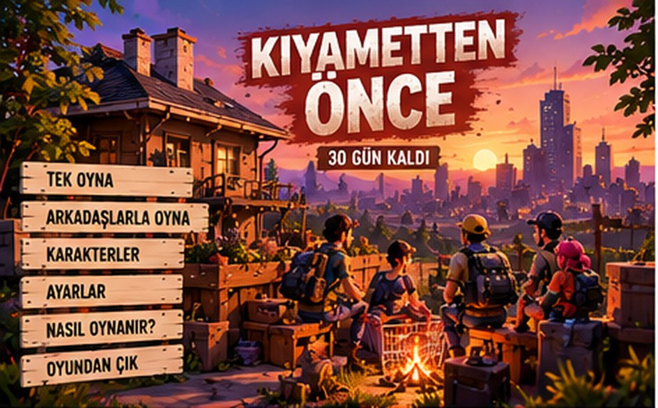

# KIYAMETTEN ÖNCE — 30 Gün Kaldı

> 30 günün kaldı. Arkadaşlarını topla. Hazırlan. Hayatta kal.

2–6 oyunculu, üçüncü şahıs kameralı, açık dünya **co-op hayatta kalma** oyunu. Bir ada, 30 gün sonra
"Son Işık" denen felaketle yutulacak. Takımınla kaynak topla, evini bir kaleye çevir, Proje Kızılçam'ın
gizemini çöz ve yedi kaçış yolundan birini hazırla. Oyun **tarayıcıda** çalışır (kurulum gerekmez); masaüstü `.exe` sürümü
için yol haritası `docs/ROADMAP.md` içinde.



## ✨ Neler var?

- **2 × 2 km ada, 18 bölge:** mahalle, şehir merkezi, hastane, liman, sanayi, askerî bölge, laboratuvar, orman,
  dağ kampı ve yeni eklenen **çiftlik köyü, deniz feneri, sahil tatil köyü, cezaevi, havaalanı, dağ köyü
  (cami), baraj ve santral, anakara köprüsü**. Göller, baraj gölü, boğaz ve anakara kıyısı.
- **Hikâye:** 30 günlük takvim, **45 rastgele olay** (paraşütlü yardım paketi, alevler içinde düşen uçak,
  Kanlı Ay, kurt sürüsü, sis, sarsıntı, cezaevi isyanı, kaçak bilim insanı, kablo hırsızları…), **14 NPC**
  (Pilot Aydın, Fener Bekçisi İsmail, Mühendis Zeynep, Muhtar Ömer, Gardiyan Necla, Murat ve Defne…) ile
  sohbet konuları ve ahlaki kararlar, 29 görev, 38 belge. Ana hikâye "Gerçeğin Peşinde" ve "Son Yayın" ile
  Kızılçam'ın sırrını anakaraya duyurmaya kadar uzanır; sonuç ekranında kararlarınıza göre bir **epilog** çıkar.
- **Zaman çizelgesi (J → Zaman Çizelgesi):** 30 günlük şerit; her günün olayları, kararlar, görevler,
  keşifler, kurtarmalar, sürüler ve kaçış hazırlıkları kronolojik olarak; yaklaşan takvim olayları ve Son Işık'a geri sayım.
- **Fizik (Rapier 3D):** sabit 60 Hz adım + enterpolasyon, kinematik karakter denetleyicisi, ışın tabanlı
  araç süspansiyonu (tutunma sınırlı direksiyon, fren, devrilme), itilebilir/patlayan nesneler, savrulan
  cesetler, kırılan kapı ve pencere enkazı, **halatla araç arkasına bağlanıp çekilen pist enkazları**,
  rüzgârla süzülen paraşütlü paketler, sarsıntıda zıplayan eşyalar.
- **Karakterler ve yaratıklar:** iskeletli Quaternius insan modelleri (klip + prosedürel katmanlı animasyon,
  takla, eğilme, yüzme, sürünme, tırmanma), iskeletli hayvanlar (kurt, geyik, erkek geyik, tilki, köpekler),
  yeni zombi türleri (sürünen, çığlıkçı, şişkin, çevik kuvvet) ve sürü taktikleri.
- **Ses:** HRTF 3B konumlandırma, duvar arkası boğuklaşma (oklüzyon), mesafeyle tiz kaybı, iç mekânda
  yankı, zemine göre ayak sesleri (çim, toprak, çakıl, kum, asfalt, ahşap, fayans, metal, su), dinamik
  prosedürel müzik + çatışmada CC0 savaş teması.

---

## ▶️ Hemen oyna (GitHub bağlantısı)

Depo herkese açık olduğu için iki yol var:

1. **Anında (kurulumsuz):** son sürümün commit kimliğiyle githack bağlantısı —
   `https://raw.githack.com/adnanerdem2000-sudo/k-yamete-haz-rl-k/<COMMIT>/index.html`
   (`<COMMIT>` yerine depo sayfasındaki son commit'in tam 40 haneli kimliğini yaz).
2. **Kalıcı adres (GitHub Pages, bir kez ayarlanır):**
   GitHub → depo → **Settings → Pages → Build and deployment → Source: "Deploy from a branch"** →
   Branch: `claude/kiyametten-once-game-0yng28`, klasör: `/ (root)` → **Save**.
   1–2 dakika sonra oyun şu adreste yayında olur:
   **https://adnanerdem2000-sudo.github.io/k-yamete-haz-rl-k/**
   (İstersen `main` dalına birleştirip `.github/workflows/pages.yml` iş akışını da kullanabilirsin.)

3. **Tek dosya (sunucu ve kurulum gerektirmez):** `npm run build:single` → `dist/KiyamettenOnce.html`
   (~45 MB; bütün kod ve varlıklar içine gömülü). Dosyayı bilgisayara kaydedip çift tıklamak yeterli; oyun
   tamamen çevrimdışı açılır (yalnız arkadaşlarla internet üzerinden oynamak bağlantı ister). Tarayıcılar
   `file://` altında modül/dosya yüklemeyi engellediği için oyunun varlık istekleri gömülü veriye yönlendirilir
   (`tools/build-single.mjs`).

Gereksinim: WebGL 2 destekli güncel bir tarayıcı (Chrome / Edge / Firefox / Safari 16+). Klavye + fare.

### Arkadaşlarla oynamak
**Arkadaşlarla Oyna → Oda Kur** → 6 haneli oda kodunu ya da **Davet Bağlantısı**'nı arkadaşına gönder →
arkadaşın **Odaya Katıl**'dan kodu girer (ya da bağlantıya tıklar) → herkes karakter seçip **Hazırım** der →
oda sahibi **Oyunu Başlat**. Bağlantı eşler arası (WebRTC / PeerJS) kurulur, sunucu kurmana gerek yoktur.
Lobide **Sesli sohbeti aç** ile mikrofonu aç; oyunda **V** tuşuna basılı tutarak konuş.

> Aynı bilgisayarda iki sekmeyle denemek için "Bağlantı: **Yerel test**" seçeneğini kullan.

---

## 💻 Yerelde çalıştırma (geliştirme)

```bash
npm install                           # araçlar ve testler (oyunun kendisi bağımlılık gerektirmez)
npx playwright install chromium       # yalnız testler için, bir kez (uçtan uca testlerin tarayıcısı)
npm start                             # http://localhost:8080
```

`npm start` yerine herhangi bir statik sunucu da olur (ör. `python3 -m http.server 8080`). Dosyayı
doğrudan `file://` ile açma: tarayıcılar ES modüllerini ve model dosyalarını o şekilde yüklemez.

### Testler

```bash
npm test             # birim testleri (envanter, ihtiyaçlar, zaman, animasyon paketi, hareket, parça birleştirme…)
npm run test:e2e     # tüm uçtan uca senaryolar sırayla (kendi sunucusunu açar; başsız Chromium + Playwright)
node tools/e2e.mjs story carry-mp             # seçili senaryolar (günlük: /tmp/e2e-<ad>.log)
node tools/scenario.mjs tests/e2e/story.mjs   # tek senaryo, elle açılmış sunucuya (`npm start`) karşı
```

Ayrıntılar: [`docs/TEST_REPORT.md`](docs/TEST_REPORT.md). Her gönderimde GitHub Actions (`.github/workflows/ci.yml`)
birim testlerini ve kısa uçtan uca duman testlerini (gerçek fare tıklamalı menü dahil) koşar.

---

## 🎮 Nasıl oynanır?

| Tuş | Eylem | Tuş | Eylem |
|---|---|---|---|
| W A S D | Hareket | Fare | Kamera / nişan |
| Shift | Koş | Sol tık / Sağ tık | Vur-ateş / nişan al |
| C / Z | Eğil / Sürün | Boşluk | Zıpla, tırman |
| **E (basılı tut)** | Ara, aç, tamir, kaldır | R | Şarjör / yaralı arkadaşı sırtla-bırak |
| 1–6, tekerlek | Hızlı erişim | Tab | Envanter |
| K | Üretim | B | Üs geliştirme (inşa) |
| M | Harita | J | Görevler / takvim / kaçış planları |
| O | Karakter | P | Takım (YZ emirleri, davet, ses) |
| F | El feneri (araçta far) | Q | İşaret (ping) |
| V | Bas-konuş | T | Sohbet |
| G | İfade çarkı | H | Hızlı tedavi (araçta korna) |
| X | Elindekini bırak | Esc | Menü |

Tüm tuşlar **Ayarlar → Kontroller**'den değiştirilebilir.

**Temel döngü:** Gündüz keşfe çık ve yağmala → akşam üsse dön, pencereleri tahtayla güçlendir, barikat
kur → gece uyuyarak zamanı hızlandır (takımın yarısı yatmalı) → takvim olaylarına, rastgele olaylara ve
sürülere hazırlan → 30. gün 22:00'ye kadar bir kaçış yolu hazırla.

**Finaller (Görevler → Kaçış Planları):** Yeraltı sığınağı · Askerî helikopter (30. gün 20:00) ·
Martı teknesi (fener yanarsa açıktaki yük gemisine) · Dağ kampı · Köprüden araç konvoyu (30. gün 21:00) ·
**Uçakla kaçış** (Pilot Aydın'ı iyileştir, uçağı onar, 60 L yakıt taşı, pisti enkazlardan temizle) ·
Son savunma. Sonuç ekranında hayatta kalanlar, üs seviyesi, kararlarınız, S–D derecesi ve epilog gösterilir.

**Yan hikâyeler:** Santralde türbini yeniden çalıştırıp adaya elektriği geri getir (sokak lambaları,
benzin pompaları) · Deniz fenerini yak, açıktaki gemiyle haberleş · Otel Mavi Koy'daki baba-kızı üsse
eskort et (tamirci Murat araç onarımını güçlendirir) · Dağ köyünü hastalıktan kurtar (köy pazarı açılır) ·
Cezaevindeki mahkûmların kaderine karar ver · Kanıtları toplayıp 147.30'dan gerçeği yayınla.

---

## 📁 Klasör yapısı

```
index.html                 giriş sayfası (import map, yükleme ekranı)
src/
  main.js, Game.js         önyükleme, ana döngü, menü sahnesi (gün batımında üs)
  Session.js               oturum: host-otoriter eylem/olay hattı, ihtiyaçlar, uyku, kayıt
  core/                    grafik (Three.js + son işlem), giriş, ayarlar, varlık yükleyici, yardımcılar
  world/                   ada arazisi, yollar, köprü, girilebilir binalar + iç mekân, bitki örtüsü, su, gökyüzü,
                           çarpışma dünyası, yol bulma ızgarası (A*)
  physics/                 Rapier 3D dünyası: sabit adım, enterpolasyon, karakter denetleyicisi, dinamik nesneler
  entities/                iskeletli karakterler (klip + prosedürel katmanlar), oyuncu, zombi ve hayvan görünümleri
  systems/                 envanter, ihtiyaçlar, zaman, ortam/hava, yağma, üretim, inşa, zombiler, savaş, araçlar,
                           NPC/hayvanlar, görevler, olaylar, finaller, harita, YZ takım arkadaşları, kayıt, ses,
                           zaman çizelgesi, hikâye dünyası (pist enkazları, uçak, fener, gemi, paket, düşen uçak)
  net/                     oda/lobi, taşıyıcılar (PeerJS + BroadcastChannel), sesli sohbet
  ui/                      arayüz yöneticisi, menüler, HUD, günlük (envanter/üretim/karakter/görevler/harita), paneller
  data/                    eşyalar, tarifler, yapılar, yağma tabloları, zombiler, hikâye (takvim, olaylar, görevler)
assets/                    CC0 modeller (GLB kitleri), sesler, yazı tipleri, konsept görselleri
vendor/                    three.js r187 (MIT), PeerJS 1.5.5 (MIT), Rapier 3D (Apache-2.0), meshoptimizer çözücü (MIT)
tests/unit, tests/e2e      birim + uçtan uca testler
tools/                     yerel sunucu, varlık paketleyici, senaryo koşucu, ekran görüntüsü aracı
docs/                      mimari, test raporu, bilinen sorunlar, yol haritası
```

Mimari ayrıntıları: [`docs/ARCHITECTURE.md`](docs/ARCHITECTURE.md) · Bilinen sorunlar:
[`docs/KNOWN_ISSUES.md`](docs/KNOWN_ISSUES.md) · Sonraki aşamalar: [`docs/ROADMAP.md`](docs/ROADMAP.md) ·
Krediler ve lisanslar: [`CREDITS.md`](CREDITS.md)
